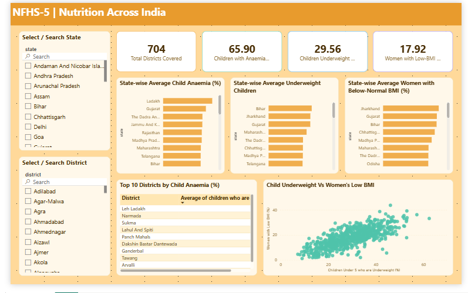

# 📊 Exploratory Data Analysis & Power BI Dashboard of NFHS-5 District-Level Health & Lifestyle Indicators


---

## 📖 Project Overview

This project presents an **Exploratory Data Analysis (EDA)** of the **National Family Health Survey (NFHS-5)** district-level dataset to investigate regional patterns in India's health, nutrition, and lifestyle indicators. The findings are also presented in an **interactive Power BI dashboard** that lets users explore the indicators by state and district.

Rather than testing predefined hypotheses, the analysis explores the dataset to uncover meaningful trends, geographic disparities, and relationships among key public health indicators through data cleaning, visualization, descriptive statistics, and correlation analysis.

The project demonstrates a complete workflow, from raw data preprocessing in Python to deriving insights from district-level health data and presenting them in an interactive dashboard.

---

## 🎯 Research Objectives

- Perform comprehensive data cleaning and preprocessing of the NFHS-5 dataset.
- Explore district-level nutrition and lifestyle indicators across India.
- Compare health outcomes at both the state and district levels.
- Identify regional disparities in nutrition and lifestyle indicators.
- Investigate relationships between lifestyle and health-related variables.
- Generate meaningful insights through visual and statistical exploratory analysis.
- Build an interactive Power BI dashboard for dynamic exploration of the key indicators.

---

## 📂 Dataset Information

| Attribute | Details |
|-----------|----------|
| **Dataset** | National Family Health Survey (NFHS-5) |
| **Survey Period** | 2019–2021 |
| **Coverage** | District-Level, India |
| **Conducted By** | International Institute for Population Sciences (IIPS) |
| **Records** | 704 Districts |
| **Variables** | 100+ Health, Nutrition, Demographic & Lifestyle Indicators |

---

## 🔬 Methodology

The project was carried out in four major stages.

### 1️⃣ Data Cleaning

- Standardized column names for consistency.
- Performed missing value analysis.
- Imputed missing values using the median where appropriate.
- Checked for duplicate records.
- Removed low-information columns.
- Validated the cleaned dataset before analysis.

---

### 2️⃣ Lifestyle Analysis

The lifestyle analysis explored behavioural health indicators across Indian districts.

Topics included:

- Tobacco consumption
- Alcohol consumption
- State-wise comparisons
- District-wise comparisons
- Maharashtra-focused analysis
- Correlation analysis
- Distribution visualizations

---

### 3️⃣ Nutrition Analysis

The nutrition analysis investigated major nutritional health indicators across Indian districts.

Topics included:

- Children underweight
- Children overweight
- Children with anaemia
- Women with low BMI
- State-wise comparisons
- District-wise comparisons
- Maharashtra-focused analysis

---

### 4️⃣ Dashboard Development

The cleaned dataset was loaded into Power BI to build a two-page interactive dashboard that brings the nutrition and lifestyle findings together in one place (see the section below).

---

## 📌 Key Findings

- Identified **Nandurbar (Maharashtra)** as a high-risk district, with **57.2%** of children classified as underweight—approximately **20 percentage points higher** than the Maharashtra average (**36.8%**), highlighting substantial district-level nutritional disparities.

- **Women with low BMI** exhibited considerable variation across Indian states. **Jharkhand** recorded the highest average prevalence (**26.9%**), while **Maharashtra** reported approximately **22%**, demonstrating significant regional differences in women's nutritional health.

- **Mizoram** reported the highest average tobacco prevalence (**74.9%**), nearly **1.9×** the overall district-level average, indicating exceptionally high tobacco consumption compared to the rest of the country.

- Correlation analysis revealed a **very weak positive relationship** between tobacco and alcohol consumption (**Pearson's r = 0.103**), suggesting that districts with higher tobacco use do not necessarily exhibit higher alcohol consumption. Alcohol consumption showed some association with mildly elevated blood pressure, while blood sugar indicators exhibited similar correlation patterns, reflecting the close relationship among metabolic health measures.

---

## 📊 Power BI Dashboard

An interactive, two-page Power BI dashboard built on the cleaned NFHS-5 data. Both pages share the same layout: filters on the left, KPI cards on top, and charts below.

### 🥗 Nutrition Page

- **KPI cards:** total districts covered, children with anaemia, children underweight, and women with low BMI.
- **State-wise bar charts:** average child anaemia, underweight children, and women with below-normal BMI.
- **Top 10 districts:** table of the districts with the highest child anaemia.
- **Scatter plot:** child underweight vs. women's low BMI, by district.

### 🚬 Lifestyle Page

- **KPI cards:** total districts covered, men using tobacco, men consuming alcohol, and a tobacco–alcohol correlation label (a DAX measure).
- **State-wise bar charts:** alcohol consumption and tobacco use among men.
- **Scatter plots:** tobacco use vs. alcohol consumption, and alcohol consumption vs. mildly elevated blood pressure, by district.

### 🎛️ Interactivity

- **State** and **District** slicers on both pages, with a search option for quickly finding a state or district.
- All visuals respond to the selected filters.

### 📸 Preview




> **To explore it:** download `dashboard/NFHS-5_Dashboard.pbix` and open it in **Power BI Desktop**.

---

## 🛠️ Tools & Libraries

- Python
- Pandas
- NumPy
- Matplotlib
- Jupyter Notebook
- Power BI (dashboard and DAX)

---

## 📁 Repository Structure

```text
NFHS-5-Data-Analysis
│
├── notebooks
│   ├── Data_Cleaning.ipynb
│   ├── Lifestyle_Analysis.ipynb
│   └── Nutrition_Analysis.ipynb
│
├── dashboard
│   ├── NFHS-5_Dashboard.pbix
│   ├── nutrition_page.png
│   └── lifestyle_page.png
│
└── README.md
```

---

## ⚠️ Limitations

- This project focuses on **exploratory data analysis** and does not establish causal relationships.
- Findings are based on observational survey data collected during **NFHS-5 (2019–2021)**.
- Statistical inference was beyond the scope of this exploratory analysis.
- The dashboard summarizes district-level percentages; it is meant for exploration, not for formal statistical conclusions.

---

## 🚀 Future Work

This project focuses on exploratory analysis of district-level health indicators. Future work could extend the analysis through statistical inference by:

- **Hypothesis Testing:** Evaluate whether observed differences in nutrition and lifestyle indicators (e.g., underweight prevalence, tobacco use, alcohol consumption, and low BMI) across states and districts are statistically significant.

- **Confidence Interval Estimation:** Construct confidence intervals for key health indicators, such as the prevalence of underweight children, anaemia, tobacco consumption, and low BMI, to quantify the uncertainty around district-level estimates.

- **Statistical Significance of Correlations:** Test whether the observed relationships between lifestyle factors (e.g., tobacco and alcohol consumption) and health indicators (e.g., blood pressure and blood sugar measures) are statistically significant.

- **Dashboard Enhancements:** Add a geographic map of districts, and publish the dashboard online (for example via Power BI Service) so it can be shared without Power BI Desktop.

---

## 👨‍💻 Author

**Pravartan Shinde**

If you found this project interesting, feel free to explore the notebooks and the dashboard, and connect with me.
